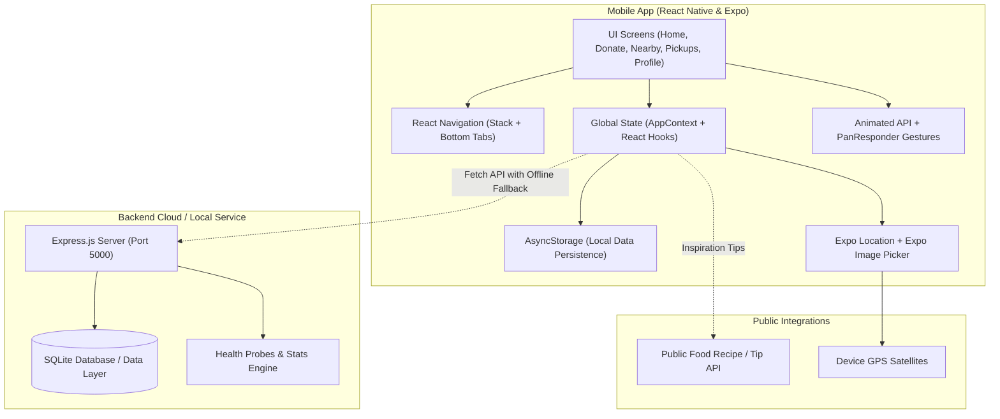

# 🍽️ Smart Food Donation & Pickup App
> **BTech Computer Science & Engineering — Mini Project**  
> *A Mobile Solution Connecting Surplus Food Donors with Community Rescuers and NGOs*

---

## 📌 1. Project Objective & Overview
In urban centers, massive quantities of perfectly edible, freshly prepared food from restaurants, hotels, banquet halls, and bakeries are discarded daily, while shelters, orphanages, and underprivileged individuals face severe food insecurity. 

The **Smart Food Donation & Pickup App** solves this problem by providing a real-time, location-aware mobile bridge:
- **Food Donors (Restaurants, Bakeries, Caterers, Households)** can list surplus food in seconds with photos, quantity, preparation time, and strict pickup deadlines.
- **Food Receivers (NGOs, Shelters, Community Kitchens, Volunteers)** can browse nearby donations on an interactive radar map, calculate live distances, and place one-tap pickup requests.
- **Zero-Hunger Direct Impact**: Prevents food waste, cuts methane emissions from landfills, and directs fresh meals to families in need.

---

## 🏗️ 2. System Architecture



---

## 📱 3. Core Features & Capabilities

| Feature | Description | Implementation Details |
| :--- | :--- | :--- |
| **🏠 Home Screen** | Interactive feed of surplus food listings with photo cards, impact statistics, and search bar. | `FlatList`, `SummaryCard`, filter chips, pull-to-refresh. |
| **👥 Dual User Roles** | Seamless switching between **Food Donor** and **Food Receiver (NGO)**. | Local demo login; no password hassle for college presentation; stored in `AsyncStorage`. |
| **➕ Donate Food** | Complete form to publish food name, category, quantity, deadline, address, and food photo. | `expo-image-picker` (Camera & Gallery), form validation, instant list update. |
| **🗺️ Nearby Map** | Real-time distance calculation and interactive coordinate radar map. | `expo-location` with permission handling, Haversine formula distance calculation, manual fallback. |
| **🔍 Donation Details** | Complete view with hero food image, dietary tags (Veg/Vegan), donor details, and direct contact. | Modal stack screen, deadline indicator, action buttons. |
| **📦 Pickup Management**| Receivers submit requests; donors accept, mark completed, or decline. | Multi-tab status tracker (`Available` ➔ `Requested` ➔ `Accepted` ➔ `Picked Up`), duplicate request prevention. |
| **👤 User Profile** | Displays user details, community impact metrics (Meals Donated / Rescued), and demo reset. | Editable profile, backend connection test modal, demo reset button. |
| **⚡ Offline / Fallback** | 100% functional even when backend is offline! | Automatically falls back to `AsyncStorage` and rich sample data with UI status indicator. |

---

## 🛠️ 4. Technology Stack & Syllabus Concept Mapping

This mini project demonstrates the complete core syllabus of modern mobile application and cloud development:

| Syllabus Concept | How It Is Implemented In This Project |
| :--- | :--- |
| **React Native Core Components** | Used `View`, `Text`, `Image`, `TextInput`, `Pressable`, `ScrollView`, `FlatList`, `SafeAreaView`, and `ActivityIndicator` across all screens. |
| **Responsive Flexbox Layouts** | Every screen uses flexible row/column alignments, auto-wrapping tags, and adaptable card layouts supporting any mobile screen size. |
| **React Hooks** | `useState` for UI state, `useEffect` for lifecycle/data fetching, `useCallback` for memoized refresh, `useMemo` for search/filter operations, `useRef` for animations. |
| **State Management** | Centralized in `AppContext.js` with custom `useApp()` hook, propagating updates across all tab screens instantaneously. |
| **Local Persistence (`AsyncStorage`)** | Preserves user profile, active role, donations, and pickup history permanently across app restarts (`asyncStorage.js`). |
| **Device Location (`expo-location`)** | Requests runtime GPS permission, gets coordinates, calculates Haversine distance in km, and provides manual landmark fallback. |
| **Camera & Photos (`expo-image-picker`)** | Snaps live food photos using camera or selects images from gallery with aspect ratio cropping (`imageService.js`). |
| **Animations (`Animated` API)** | Smooth card entrance slide & fade effects, interactive button press scaling/bouncing, and swipeable gesture cards (`SwipeableCard.js`). |
| **Gestures & PanResponder** | Horizontal swipe gesture revealing quick action drawers without external complex native plugins. |
| **Fetch API & REST Integration** | Communicates with Express API using `fetch` with timeout and offline graceful degradation; retrieves public tips via Fetch API. |
| **Backend & Database** | Node.js, Express, and built-in native SQLite database with auto-migration schema. |
| **Containerization (Docker)** | Multi-stage `Dockerfile` and `docker-compose.yml` for backend deployment. |
| **Kubernetes Orchestration** | `k8s/deployment.yaml` with liveness/readiness probes, resource limits, and `k8s/service.yaml` NodePort service. |
| **CI/CD Automation** | GitHub Actions pipeline (`.github/workflows/ci.yml`) automating backend test execution and container verification. |

---

## 🚀 5. Getting Started on Windows

### Prerequisites
1. **Node.js**: Installed (v18, v20, or v24 LTS). Verify with:
   ```powershell
   node -v
   npm -v
   ```
2. **Git**: Installed. Verify with:
   ```powershell
   git --version
   ```
3. **Expo Go Mobile App** *(Recommended for testing on your phone)*:
   - Download **Expo Go** from Google Play Store (Android) or Apple App Store (iOS).

---

### Step 5.1: Run the Backend API (Terminal 1)

1. Open a PowerShell terminal and navigate to the backend directory:
   ```powershell
   cd backend
   ```
2. Install dependencies:
   ```powershell
   npm install
   ```
3. Run the automated backend test suite:
   ```powershell
   npm test
   ```
   *(You should see all 7 tests passing with green checkmarks!)*
4. Start the backend server:
   ```powershell
   npm start
   ```
   *The server will run on `http://localhost:5000` with SQLite database initialized automatically in `backend/data/food_donation.db`.*

---

### Step 5.2: Run the Mobile Application (Terminal 2)

1. Open a **second** PowerShell terminal in the project root directory:
   ```powershell
   npm install --legacy-peer-deps
   ```
2. Start the Expo development server:
   ```powershell
   npx expo start
   ```
3. Choose your viewing mode:
   - **On Physical Mobile Phone (Best Demo)**: Open the **Expo Go** app on your phone and scan the QR code printed in the terminal.
   - **In Web Browser**: Press `w` in the terminal to launch the web preview in Google Chrome or Edge.
   - **On Android Emulator**: Press `a` in the terminal (if Android Studio emulator is running).

---

## 🐳 6. Docker & Container Deployment

### Running the Backend with Docker Compose
```powershell
# Build and run backend container
docker compose up --build

# Verify running container
docker ps

# Test health check endpoint in browser or curl
curl http://localhost:5000/api/health

# Stop containers
docker compose down
```

---

## ☸️ 7. Kubernetes Deployment (Optional / College Demo)

```bash
# 1. Apply Kubernetes Deployment (2 replicas + health checks)
kubectl apply -f k8s/deployment.yaml

# 2. Apply NodePort Service
kubectl apply -f k8s/service.yaml

# 3. Check deployment status
kubectl get deployments
kubectl get pods
kubectl get services

# 4. Access the API via NodePort
curl http://<Node-IP>:30500/api/health
```

---

## 🐙 8. Git & GitHub Commands

To commit this project and publish to your own GitHub repository:

```powershell
# 1. Check repository status
git status

# 2. Stage all project files
git add .

# 3. Commit with a descriptive message
git commit -m "feat: complete Smart Food Donation & Pickup App for BTech CSE mini project"

# 4. Link your remote GitHub repository (replace with your repo URL)
git remote add origin https://github.com/YOUR_USERNAME/smart-food-donation-app.git

# 5. Push to GitHub main branch
git branch -M main
git push -u origin main
```

---

## 🎬 9. Examiner Demonstration Script (Viva Walkthrough)

Follow this 5-minute step-by-step sequence during your project evaluation:

| Step | Action | What to Explain to the Examiner |
| :---: | :--- | :--- |
| **1** | **Launch App** | Point out the clean splash screen and onboarding screen where user chooses **Donor** or **Receiver** role. |
| **2** | **Home Screen** | Highlight the **Impact Summary Card** (Available Meals, Rescued Meals), category filter pills (Cooked Meals, Bakery, Fruits), search bar, and public API food conservation tip. |
| **3** | **Swipe Gesture** | Swipe left on any food card to show the **SwipeableCard** interaction revealing the quick action drawer. |
| **4** | **Nearby Map** | Open the **Nearby** tab. Show the **interactive radar map** showing user location beacon and donation pins with exact distances calculated via the **Haversine formula**. Tap "Change City Area" to change landmark and show how distances recompute dynamically. |
| **5** | **Donate Food** | Tap the **Donate** tab. Fill out the form, tap "Food Photo" to pick an image, click **Publish Food Donation**. Return to Home to demonstrate that the listing appears **immediately**. |
| **6** | **Pickup Flow** | Switch role to **Receiver** (via the top-right button). Open a donation, click **Request Food Pickup**, enter arrival time ("Within 30 mins"). Point out that duplicate requests are prevented! |
| **7** | **Pickup Management** | Go to **My Pickups** tab. Show active requests. Switch back to Donor and click **Accept Request** and **Mark as Picked Up**. Point out that the badge count decrements and the item moves to **History**. |
| **8** | **Offline Fallback** | Show that even if the backend is stopped, all data persists seamlessly using **AsyncStorage**. |
| **9** | **Reset Demo** | Open **Profile** ➔ click **Reset All Demo Data** to restore clean initial sample state for the next demonstration. |

---

## 📋 10. Test Cases for College Project Examination

| Test ID | Module | Test Scenario | Input / Action | Expected Result | Result |
| :---: | :--- | :--- | :--- | :--- | :---: |
| **TC-01** | Role Switch | Switch from Donor to Receiver | Tap role badge on header or profile | Active profile and UI actions adapt instantly | **PASS** |
| **TC-02** | Form Validation | Submit donation with empty fields | Leave food name and quantity empty | Form displays inline errors; blocks submission | **PASS** |
| **TC-03** | Image Picker | Upload food photo | Select photo from gallery or camera | Image preview renders with remove button | **PASS** |
| **TC-04** | Nearby Radar | Recompute distances on location change | Select "Indiranagar" landmark | Radar map pins re-align; distances update in km | **PASS** |
| **TC-05** | Duplicate Request | Receiver requests same food twice | Tap "Request Food Pickup" twice | Second attempt displays "Request Placed" notice | **PASS** |
| **TC-06** | Status Workflow | Progress from Requested to Picked Up | Donor accepts and marks completed | Status moves to history; stats increment | **PASS** |
| **TC-07** | Persistence | Restart app | Close and relaunch app | Previously entered donations remain intact | **PASS** |
| **TC-08** | Backend Health | API automated test suite | Run `npm test` in `backend/` | All 7 RESTful API endpoints pass cleanly | **PASS** |
| **TC-09** | Offline Fallback | Stop Express server | Browse app in offline state | App shows "Demo Mode" and functions smoothly | **PASS** |

---

## 👥 Authors
- **BTech Computer Science & Engineering**
- Mini Project Final Submission
